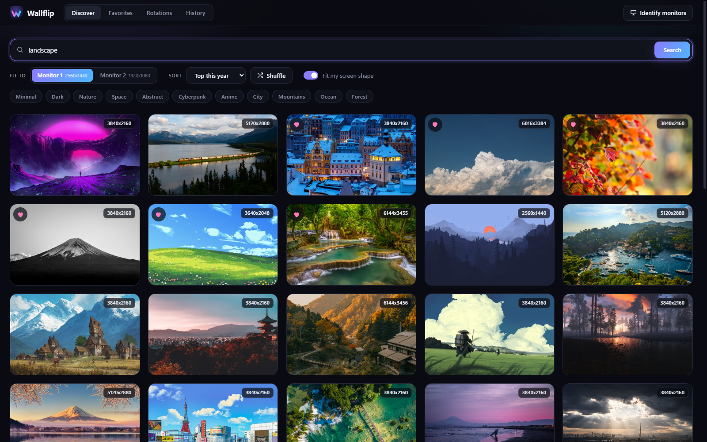
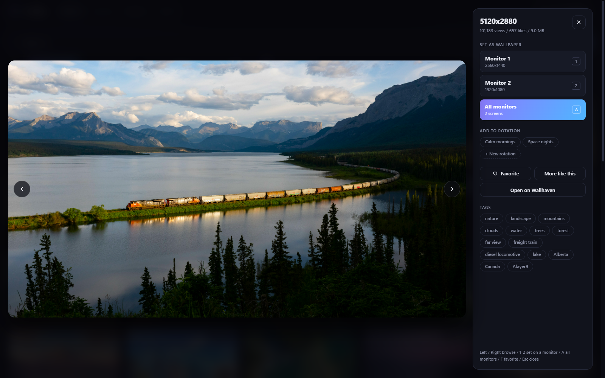
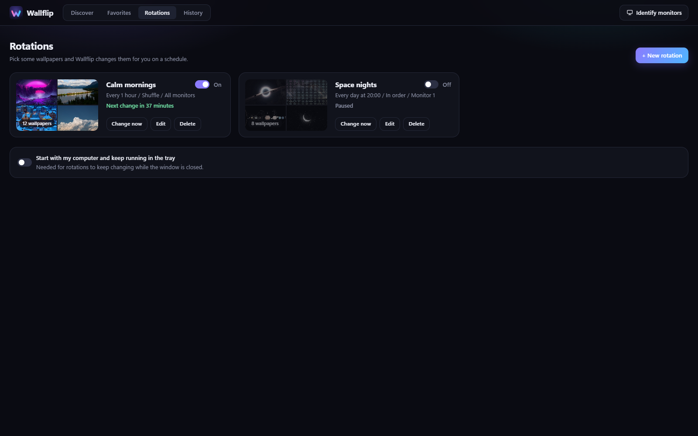
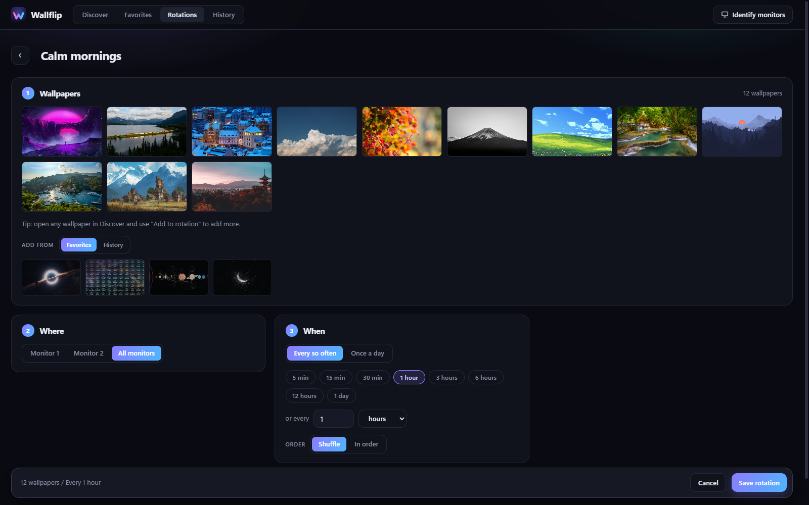
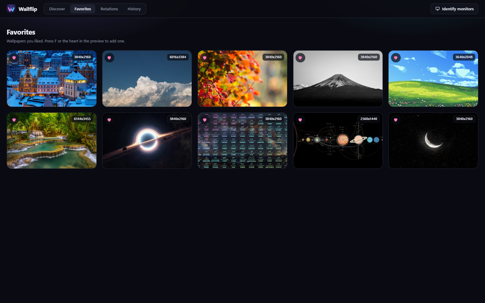
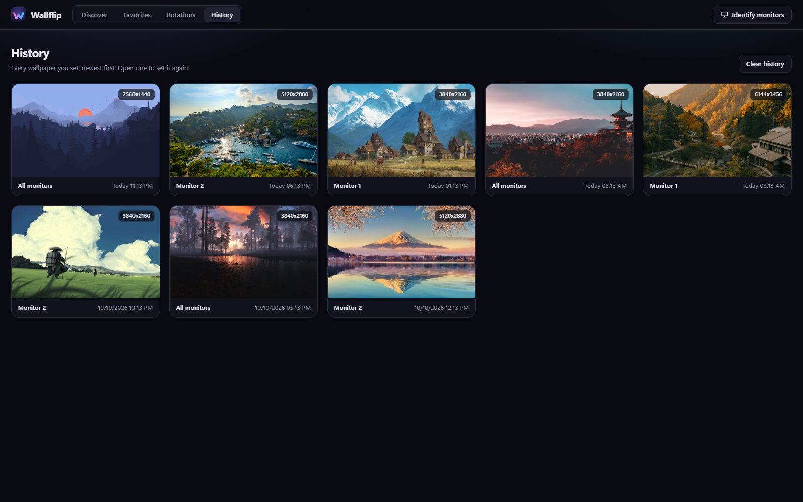

<p align="center">
  
</p>

<h1 align="center">Wallflip</h1>

<p align="center">
  <b>Fresh wallpapers for every screen, one click away.</b><br>
  Find gorgeous wallpapers that fit your monitors perfectly, set them instantly, and let them change on their own.
</p>

<p align="center">
  <a href="https://github.com/vvanouytsel/wallflip/releases/latest"></a>
  <a href="https://github.com/vvanouytsel/wallflip/releases"></a>
  
  <a href="LICENSE"></a>
</p>

<p align="center">
  <a href="https://github.com/vvanouytsel/wallflip/releases/latest/download/Wallflip-Setup.exe"><b>Download for Windows</b></a>
  &nbsp;&middot;&nbsp;
  <a href="https://github.com/vvanouytsel/wallflip/releases/latest/download/Wallflip-mac.dmg">macOS</a>
  &nbsp;&middot;&nbsp;
  <a href="https://github.com/vvanouytsel/wallflip/releases/latest/download/Wallflip-linux.AppImage">Linux</a>
</p>

<br>

<p align="center">
  
</p>

<br>

## Your desktop deserves better than the same old picture

Changing wallpapers usually means hunting through websites, checking if an image is big enough, downloading it, and digging through settings. **Wallflip turns all of that into a single click.**

<table>
  <tr>
    <td width="33%" valign="top">
      <h3>🖥️ Made for your screens</h3>
      Wallflip knows every monitor you have. It only shows wallpapers that are sharp enough and the right shape, so nothing ever looks stretched or blurry.
    </td>
    <td width="33%" valign="top">
      <h3>⚡ One click and done</h3>
      Love what you see? Set it on one monitor or all of them instantly. No downloading, no settings menus.
    </td>
    <td width="33%" valign="top">
      <h3>🔁 Changes by itself</h3>
      Pick a few favorites and Wallflip rotates them for you: every hour, every morning, whatever you like.
    </td>
  </tr>
</table>

<br>

## A closer look

### Find something you love

Search any theme, like *forest*, *space*, *city* or *minimal*, or tap one of the quick themes. Keep scrolling and new wallpapers keep coming. Every wallpaper comes from [Wallhaven](https://wallhaven.cc), one of the biggest wallpaper collections around.

### See it big, set it fast

Open any wallpaper for a full-size look. Pick the monitor you want, or put it on all of them at once. Browse with the arrow keys, see its tags, or find more wallpapers just like it.

<p align="center">
  
</p>

### Let your wallpaper change on its own

Make a rotation, add the wallpapers you like, and choose when they change: every few minutes, every few hours, or once a day at a set time. Shuffle them or play them in order. Give each monitor its own rotation if you want.

<table>
  <tr>
    <td width="50%"></td>
    <td width="50%"></td>
  </tr>
  <tr>
    <td align="center"><sub>All your rotations at a glance</sub></td>
    <td align="center"><sub>Set one up in three simple steps</sub></td>
  </tr>
</table>

### Never lose a good one

Tap the heart to save wallpapers to your favorites. Everything you've ever set is kept in your history, so you can bring back an old favorite in a second.

<table>
  <tr>
    <td width="50%"></td>
    <td width="50%"></td>
  </tr>
  <tr>
    <td align="center"><sub>Favorites</sub></td>
    <td align="center"><sub>History</sub></td>
  </tr>
</table>

<br>

## And a few more nice touches

- **Which screen is which?** Press *Identify monitors* and a big number appears on each screen.
- **Keyboard friendly.** Use the arrow keys to browse, `1` `2` `3` to set on a monitor, `A` for all of them and `F` to favorite.
- **Stays out of your way.** Wallflip can start with your computer and keep running quietly in the tray, so your rotations keep going.
- **Remembers you.** Your last search, sort and monitor are waiting for you next time.

<br>

## Get started in a minute

1. **[Download Wallflip](https://github.com/vvanouytsel/wallflip/releases/latest/download/Wallflip-Setup.exe)** for Windows.
2. Open the file. Wallflip installs itself and adds a shortcut to your desktop and Start menu.
3. Search for something you like and click **Set as wallpaper**. That's it!

> [!NOTE]
> Wallflip is new, so Windows may show a blue "Windows protected your PC" screen the first time. Click **More info** and then **Run anyway**.
> On a Mac, right-click the app and choose **Open** the first time.

Versions for **macOS** and **Linux** are on the [releases page](https://github.com/vvanouytsel/wallflip/releases/latest). They are newer and less tested than the Windows version.

<br>

## Credits

Wallpapers are found through [Wallhaven](https://wallhaven.cc). Every image belongs to its artist or photographer. Please respect their work and licences.

<details>
<summary><b>For developers</b></summary>

<br>

Wallflip is an [Electron](https://www.electronjs.org) app.

```bash
npm install
npm start
```

- `npm run screenshots` refreshes the pictures in this README.
- `npm run dist` builds an installer for your computer into `dist/`.
- Commits follow [Conventional Commits](https://www.conventionalcommits.org). Releases are made automatically.

</details>

<br>

<p align="center">
  <br>
  <sub>Made with care. Released under the <a href="LICENSE">MIT license</a>.</sub>
</p>
